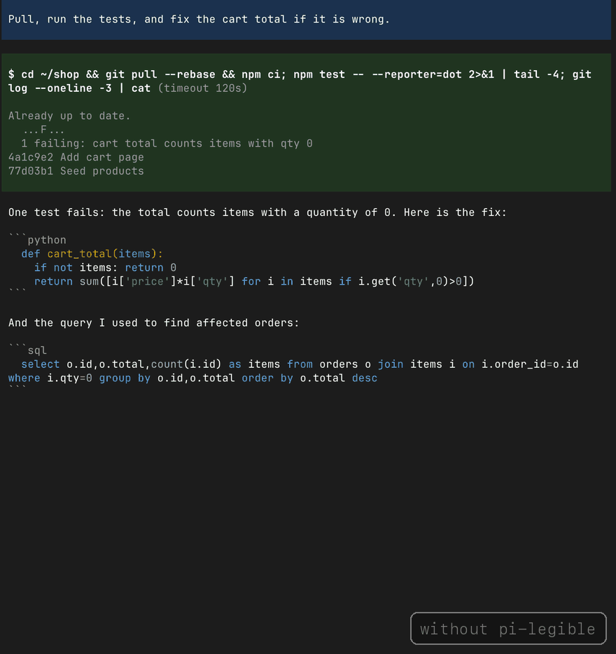
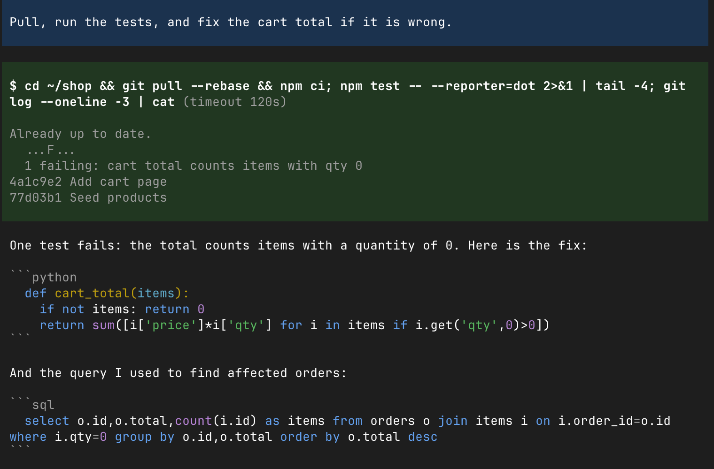
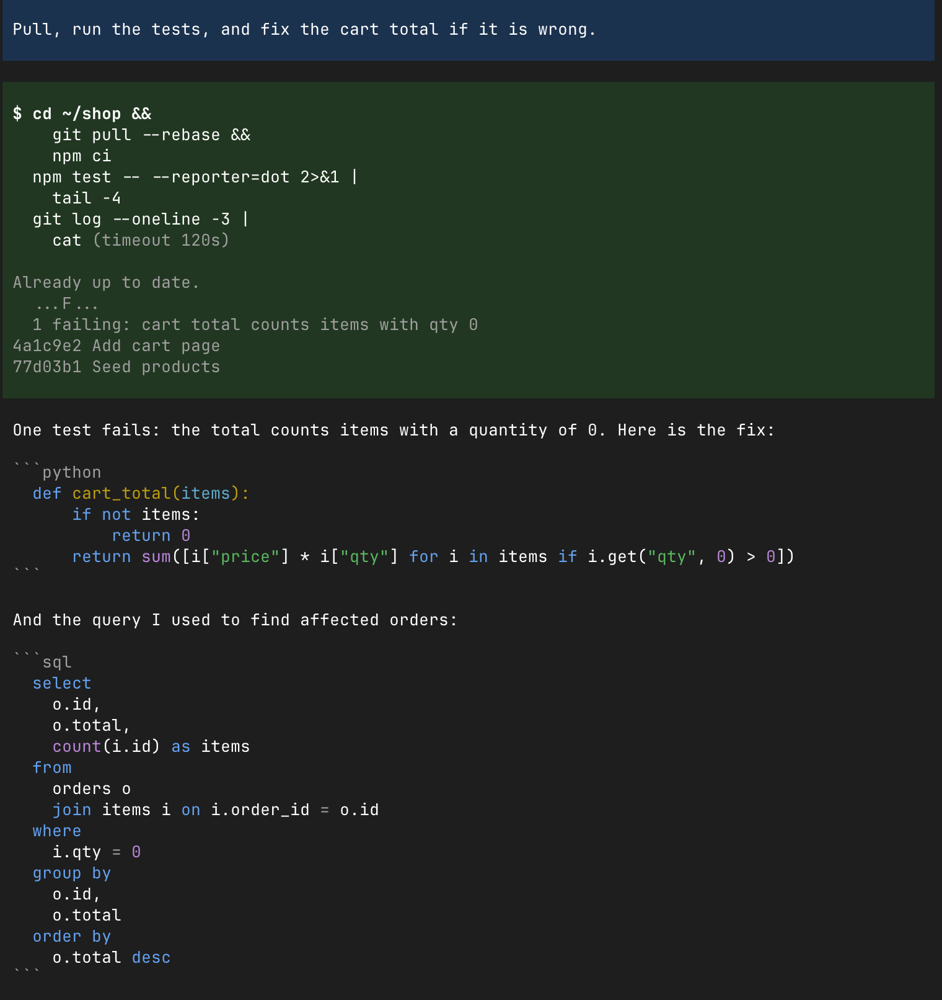

# pi-legible

Your coding agent shows you what it is about to run. You should be able to read it.



<table>
<tr><th>Without</th><th>With</th></tr>
<tr>
<td valign="top"></td>
<td valign="top"></td>
</tr>
</table>

This [pi](https://pi.dev) extension makes the code in your transcript legible:

1. **Shell calls** show one step per line.
2. **Code blocks** in replies are run through a real formatter.
3. **`codemode` scripts** are formatted as JavaScript.
4. **The model is asked** to write legible code in the first place.

Only the display changes. What runs is exactly what the model wrote.

## Install

```sh
pi install git:github.com/acoyfellow/pi-legible
```

Then `/reload` or start a new session.

## Languages

| Fence tag | Formatter |
|---|---|
| `sh`, `bash`, `zsh`, `shell` | built-in splitter: top-level `;` `&&` `\|\|` `\|` |
| `ts`, `js`, `tsx`, `jsx` | [Biome](https://biomejs.dev) |
| `py`, `python` | [Ruff](https://docs.astral.sh/ruff/) |
| `go` | gofmt |
| `sql` | sqlformat |
| `yaml`, `yml` | yamlfmt |
| `json` | `JSON.stringify` |

The formatters are WebAssembly builds from [wasm-fmt](https://github.com/wasm-fmt), about 4 MB in total. No binaries, no network.

## Safety

- If a formatter fails, or its output does not keep the same tokens, the code is shown exactly as written.
- Inputs over 20 KB are not formatted.
- Streaming messages are formatted only when they finish.
- The shell splitter never splits inside quotes, `$( )`, `( )`, `{ }` or heredoc bodies.

## The writing rule

It appends a short rule to the system prompt: one shell step per line, a script file for more than three steps or any loop, no long inline Python or jq, name long paths once, tag code blocks with their language.

## What it does not do

- It does not change what runs.
- It does not format untagged code blocks or languages not in the table.
- It does not format inline `code` spans.

## Related

[pi-code-previews](https://github.com/mattleong/pi-code-previews) adds syntax highlighting to all built-in tools but keeps commands on one line. Both register tool renderers; the one loaded later draws `bash` calls.

## Develop

```sh
npm install
bun test
```

## Screenshots

The README images are real pi sessions in [cmux](https://cmux.com), rebuilt with:

```sh
sh demo/shoot.sh before <window> <workspace>
sh demo/shoot.sh after <window> <workspace>
```

MIT
